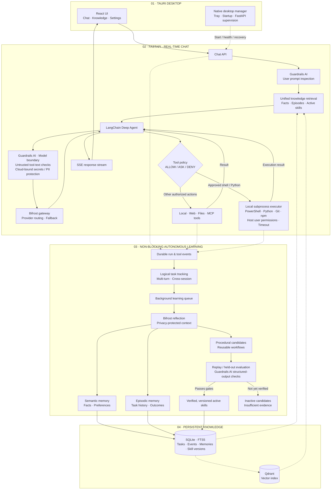

<p align="center">
  
</p>

<h1 align="center">Trajecta</h1>

<p align="center"><strong>A desktop AI agent that learns from experience.</strong></p>

<p align="center">Chat · Tools · Knowledge · Background learning · Human control</p>

---

> **Status:** Active development.

## What Trajecta does

- **Agentic chat:** Streaming conversations, tool activity, optional provider-supplied reasoning, attachments, document retrieval, message editing, regeneration, and branching.
- **Workspace tools:** Select folders per conversation; work with files, code, shell commands, Git, web search, browsers, documents, and MCP tools. Desktop computer control is opt-in.
- **Persistent knowledge:** Short-term, semantic, episodic, and procedural memory with conversation search, hybrid retrieval, and maintenance tools. SQLite, full-text search, and embedded Qdrant store local data; Ollama embeddings are optional.
- **Background learning:** Durable reflection of completed runs and feedback, experience tracking, reusable skill candidates, evaluation, versioning, regression detection, and controlled promotion or rollback.
- **Human control:** ALLOW / ASK / DENY tool permissions, approval and clarification prompts, Guardrails AI checks for prompt injection and sensitive data, and verification for configured external actions.
- **Scheduled tasks:** Run one-time or recurring agent jobs with persisted execution history.
- **Model choice:** Chat through **Bifrost** with selectable models and an optional local Ollama setup. Configure providers, API keys, and routing in the Bifrost dashboard—not in Trajecta.
- **Desktop startup:** Restore settings and conversations, start local services and learning, check selected local models, and display warnings when services are unavailable.

## LLM gateway ownership

**Bifrost is Trajecta's model gateway**

- Open **Bifrost Dashboard** in the sidebar (or **Settings → LLM Gateway & Models → Open Bifrost dashboard**) to configure providers, credentials, upstream endpoints, virtual keys, routing rules, budgets and fallback chains. The link uses the gateway URL configured for this installation.
- Choose the model for **new conversations** in Trajecta Settings. Select a model discovered from Bifrost.
- The Windows installer creates a unique, persistent Trajecta virtual key at `%LOCALAPPDATA%\ai.trajecta.desktop\data\bifrost\virtual-key` and seeds `data/bifrost/config.json` with only Trajecta's governance entry. On upgrades it retains providers, other virtual keys and routing settings.

## Architecture



The chat response **does not wait for task classification, reflection, or skill evaluation**. Individual runs retain their event history, while logical tasks can continue across turns or sessions. Task association currently uses conservative heuristics rather than perfect semantic understanding. Inactivity can checkpoint a task without marking it successful.

## Install from a Git clone (Windows)

### Prerequisites

- Windows 10/11 and Microsoft Edge WebView2.
- Git, Node.js 22+, pnpm, and [uv](https://docs.astral.sh/uv/).
- Rust toolchain with the MSVC target and Visual Studio C++ build tools (for Tauri); see [Tauri 2 prerequisites](https://v2.tauri.app/start/prerequisites/).
- Internet access to download dependencies on first installation. `uv` provisions Python 3.11 for the managed backend.
- Model credentials configured in the **Bifrost** dashboard for AI chat. The Windows installer provisions a managed gateway launcher and a persistent Trajecta virtual key; the gateway executable downloads on first launch.

### First installation

Run these in PowerShell (replace the repository URL with your actual Git remote):

```powershell
git clone https://github.com/cRED-f/Trajecta.git
cd Trajecta
pnpm trajecta:install
trajecta
```

### Persistent data and updates

The installed application uses an isolated writable directory rather than storing live data inside the source checkout:

```text
%LOCALAPPDATA%\ai.trajecta.desktop\
├── runtime\Trajecta.exe         # Locally compiled desktop executable
├── runtime\venv\                # Managed Python backend
├── data\.trajecta\              # Conversations, SQLite, Qdrant, skills and uploads
├── logs\backend.log             # FastAPI startup/runtime diagnostics
├── desktop.json                 # Desktop preferences
└── install.json                 # Git checkout reference
```

## Repository layout

```text
Trajecta/
├── apps/desktop/            # React / Tauri desktop app and settings
├── cli/                     # Single global trajecta launcher
├── scripts/                 # Local install, update, and uninstall helpers
├── server/src/
│   ├── api/                 # FastAPI endpoints
│   ├── chat/                # Conversation and streaming orchestration
│   ├── guardrails/          # Guardrails AI content/privacy checks and tool policy
│   ├── memory/              # Task tracking, reflection, retrieval and storage
│   ├── skills/              # Candidates, evaluation, promotion and rollback
│   ├── tools/               # Local tools and MCP integrations
│   └── llm_gateway/         # Bifrost integration
├── config/                  # Defaults and guardrail rules
├── pyproject.toml
└── SOURCE_INSTALL.md
```

## Further documentation

- [Source installation and recovery](SOURCE_INSTALL.md)
- [Desktop](apps/desktop/REQUIREMENTS.md) · [Backend](server/REQUIREMENTS.md)
- [Memory](server/src/memory/REQUIREMENTS.md) · [Skills](server/src/skills/REQUIREMENTS.md)
- [Guardrails](server/src/guardrails/REQUIREMENTS.md) · [Tools](server/src/tools/REQUIREMENTS.md)
- [LLM gateway](server/src/llm_gateway/REQUIREMENTS.md) · [Observability](server/src/observability/REQUIREMENTS.md)

## License

[MIT](LICENSE)
